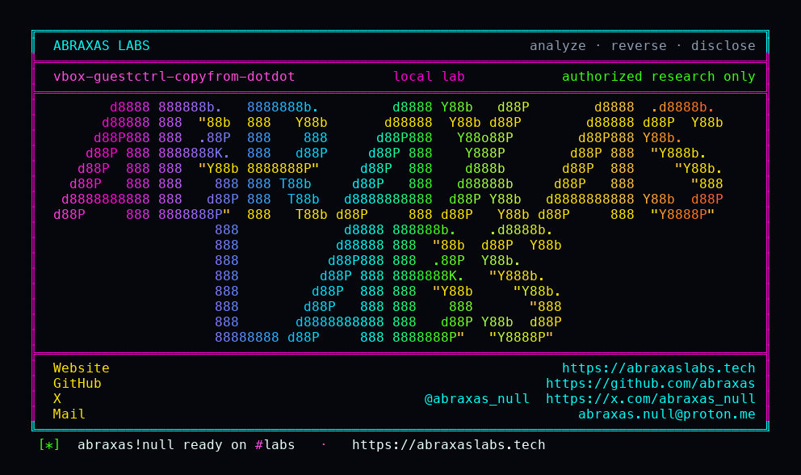

<p align="center">
  
</p>

<p align="center">
  <a href="https://abraxaslabs.tech"><strong>abraxaslabs.tech</strong></a>
  &nbsp;·&nbsp;
  <a href="https://github.com/abraxas">github.com/abraxas</a>
  &nbsp;·&nbsp;
  <a href="https://x.com/abraxas_null">@abraxas_null</a>
  &nbsp;·&nbsp;
  <a href="mailto:abraxas.null@proton.me">abraxas.null@proton.me</a>
  &nbsp;·&nbsp;
  <a href="https://github.com/abraxas/vbox-guestctrl-copyfrom-dotdot">vbox-guestctrl-copyfrom-dotdot</a>
</p>

# vbox-guestctrl-copyfrom-dotdot

**Class:** File write
**Reach:** Local (guest) confused-deputy

**Oracle VM VirtualBox OSS** `7.2.20` (`f2792cf44`) - Oracle

Host `IGuestSession::directoryCopyFromGuest` / `VBoxManage guestcontrol copyfrom` concatenates guest `DIR_NOTIFY` names onto the dest. `FsList::AddDirFromGuest` skips exact `.` and `..` only. `GuestPath::Translate` is slash style plus double-slash collapse. `BuildDestinationPath` rejects `RTPATH_PROP_DOTDOT_REFS` on the dest root the host named, not on per-entry names.

**A guest that answers a host-initiated directory copy-from with names containing `..` writes files as the VBox UID outside the dest.**

| | |
|---|---|
| ID | no CVE yet |
| Class | **File write** (host dest escape) |
| Reach | **Local (guest)** confused-deputy. Host starts the copy. Guest names the files. |
| CWE | [CWE-22](https://cwe.mitre.org/data/definitions/22.html) |
| CVSS | **High: 8.2** `CVSS:3.1/AV:L/AC:L/PR:L/UI:R/S:C/C:H/I:H/A:N` |
| Product | [Oracle VM VirtualBox OSS](https://github.com/VirtualBox/virtualbox) |
| Affected | **7.2.20** (`f2792cf44f663989818507e36d3db5f978523c5e`) |
| Auth | Guest Additions (or a replacement HGCM client) plus a host-initiated directory copy-from |
| License | [GNU Affero GPL v3.0](LICENSE) |
| Lab | `127.0.0.1` only. Source harness. Does not boot VirtualBox. |

## What an attacker can do

Guest Control is host-to-guest by design. The leftover is the reverse: the host user copies a guest directory, and the guest answers `HOST_MSG_DIR_READ` with `GUEST_MSG_DIR_NOTIFY` / `GUEST_DIR_NOTIFYTYPE_READ` names. Main concatenates those names onto dest and opens them.

### Integrity (lab-proven)

| Method | Sink | Privilege |
|---|---|---|
| Host `IGuestSession::directoryCopyFromGuest` / `VBoxManage guestcontrol copyfrom` of a guest directory. Guest listing name `../oracle/VBOX-GUESTCTRL-COPYFROM-DOTDOT-WITNESS`. | `CopyFrom::Run` does `strDstAbs = dest + native_sep + pEntry->strPath`, then `GuestPath::Translate`, then `fileCopyFromGuest` -> `RTFileOpen(RTFILE_O_WRITE \| RTFILE_O_OPEN_CREATE)`. | Create/overwrite a host file **outside dest** as the VBox UID. Lab dest `/work/vbox-copy`. Lab wrote `/work/oracle/VBOX-GUESTCTRL-COPYFROM-DOTDOT-WITNESS`. Content is guest-chosen (file-read notify). |

Exact `.` and `..` directory names are skipped and do not write. A file whose **name** contains `..` is stored and joined.

### Integrity (inferred, not in this lab)

| Method | Sink | Privilege |
|---|---|---|
| Same copy-from. Guest lists `../../../.ssh/authorized_keys` (or DOS `..\..\...`) while the host dest is `/tmp/vbox-copy` / `C:\Temp\vbox-copy`. | Same join + `RTFileOpen`. | Create or overwrite any host path that UID can write. Nested `--recursive` names walk further. |

### Recon

None beyond the dest the host already chose. The guest does not learn extra host paths from this leftover.

### Availability (inferred)

Overwrite of files the VBox UID can write. Not a crash leftover. CVSS `A:N`.

### What this leftover does not grant

- Host kernel. Other VMs. VBoxSVC.
- Single-file `fileCopyFromGuest`: dest is fully host-specified; guest only supplies bytes into that path.
- Copy-to-guest: dest is on the guest. `AddDirFromHost` skips `.` / `..` on the host listing.
- Files the VBox UID cannot write (`/etc` as a normal user, another user's home).
- Windows restricted token / AppContainer. This is the VBox user process writing, not a hardening bypass.
- Guest injection of `HOST_MSG_*`. `svcCall` only dispatches `GUEST_MSG_*`.
- Path sanitizer in `guestCtrlValidateDirEntryEx`. That check is UTF-8/size, not `..`.

Needs Guest Additions (or a replacement HGCM client that owns the session) **and** a host-initiated directory copy-from. No 3D. No VRDP. Not PUEL. Confused-deputy: the host user copies from a hostile guest.

## How I found it

I pinned [VirtualBox/virtualbox](https://github.com/VirtualBox/virtualbox) **v7.2.20** (`f2792cf44`). Guest Control hunt H04. Guest-to-host only. Shared-folder TOCTOU (P0 1037) is a sibling class on a different service and is closed on this pin (`RTPathStartsWith` after lexical abs). Guest Control copy-from concatenates **DIR_NOTIFY** names, not SHFL names.

`AddDirFromGuest` builds `strEntry` from the guest `Name` and skips only exact `.` / `..`:

```cpp
Utf8Str strEntry = strPathSub + Utf8Str(bstrName);
switch (enmObjType)
{
    case FsObjType_Directory:
    {
        if (   bstrName.equals(".")
            || bstrName.equals(".."))
        {
            break;
        }
        vrc = AddDirFromGuest(strPath, strEntry);
        break;
    }
    case FsObjType_File:
        vrc = AddEntryFromGuest(strEntry, fsObjInfo->i_getData());
        break;
}
```

`CopyFrom::Run` then concatenates the stored path onto dest and only **Translates**:

```cpp
strDstAbs += PATH_STYLE_SEP_STR(PATH_STYLE_NATIVE);
strDstAbs += pEntry->strPath;
vrc = GuestPath::Translate(strDstAbs, mSession->i_getGuestPathStyle(), PATH_STYLE_NATIVE);
/* directoryCreateOnHost / fileCopyFromGuest -> RTFileOpen WRITE|OPEN_CREATE */
```

`GuestPath::BuildDestinationPath` documents "Dotdot directories are forbidden for security reasons" and rejects `RTPATH_PROP_DOTDOT_REFS`. That call is only on the dest root (`GuestSessionImplTasks.cpp:1685-1686`). Per-entry names never go through it. `Translate` (`GuestCtrlPrivate.cpp:2129-2208`) changes slash style and collapses `//`. It does not reject `..`.

Wrong turns already recorded: treating the exact `.` / `..` skip as a path sanitizer; assuming `Translate` canonicalizes; applying the dest-root check to each entry; booting a VM instead of a source harness; claiming this is host-kernel escape; treating single-file copy-from dest or copy-to-guest as the leftover. Theatre: a reverse shell. The oracle is a witness file outside dest.

## Lab

```bash
cd lab
./run.sh
```

Compose project `vbox-guestctrl-copyfrom-dotdot`. Loopback `127.0.0.1:19220`. Source harness of pin `v7.2.20` peel `f2792cf44`: skip of exact `.` / `..`, `GuestPath::Translate` (slash style only), `CopyFrom::Run` dest+sep+entry join then write/create, dest-root `BuildDestinationPath` DOTDOT reject. Does not boot VirtualBox or Guest Additions. Bind it to loopback.

```text
SUCCESS vbox-guestctrl-copyfrom-dotdot skip-dot=yes translate-keeps-dotdot=yes escaped-write=yes dest-root-check-unused-per-entry=yes VBOX-GUESTCTRL-COPYFROM-DOTDOT-WITNESS
```

## The fix

Run each joined dest through `GuestPath::BuildDestinationPath` (or `RTPathParse` `RTPATH_PROP_DOTDOT_REFS`, or `RTPathAbsEx` with `RTPATHABS_F_STOP_AT_BASE` against dest). Reject listing names whose components include `..`, not only exact `.` and `..`. Keep the dest-root check. It is not enough by itself.

## References

- [github.com/VirtualBox/virtualbox](https://github.com/VirtualBox/virtualbox) tag [v7.2.20](https://github.com/VirtualBox/virtualbox/releases/tag/v7.2.20) (`f2792cf44f663989818507e36d3db5f978523c5e`)
- [`GuestSessionImplTasks.cpp`](https://github.com/VirtualBox/virtualbox/blob/f2792cf44f663989818507e36d3db5f978523c5e/src/VBox/Main/src-client/GuestSessionImplTasks.cpp) `AddDirFromGuest` (1195-1235), dest-root `BuildDestinationPath` (1685-1686), `CopyFrom::Run` join (1806-1849), `fileCopyFromGuest` `RTFileOpen` (684-693)
- [`GuestCtrlPrivate.cpp`](https://github.com/VirtualBox/virtualbox/blob/f2792cf44f663989818507e36d3db5f978523c5e/src/VBox/Main/src-client/GuestCtrlPrivate.cpp) `BuildDestinationPath` (2067-2104) · `Translate` (2129-2208)
- [`GuestDirectoryImpl.cpp`](https://github.com/VirtualBox/virtualbox/blob/f2792cf44f663989818507e36d3db5f978523c5e/src/VBox/Main/src-client/GuestDirectoryImpl.cpp) `GUEST_DIR_NOTIFYTYPE_READ` (523-561)
- [`GuestCtrlImplPrivate.h`](https://github.com/VirtualBox/virtualbox/blob/f2792cf44f663989818507e36d3db5f978523c5e/src/VBox/Main/include/GuestCtrlImplPrivate.h) `guestCtrlValidateDirEntryEx` (1546-1559)
